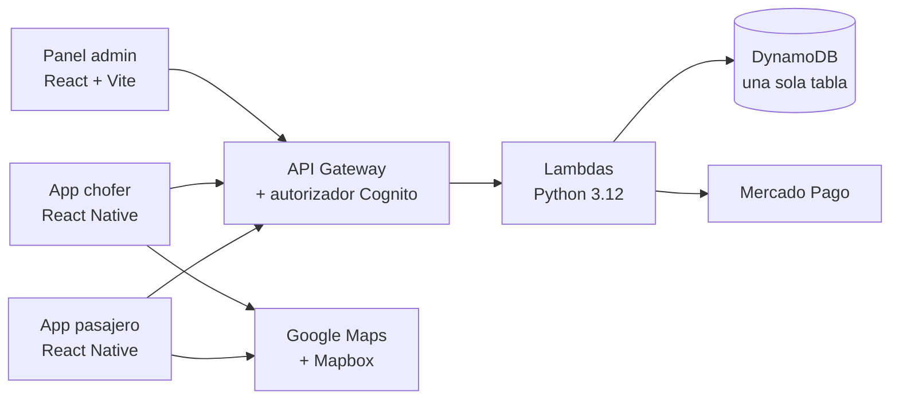

<a href="README.md">🇬🇧 English</a> · <b>🇲🇽 Español</b>

  <picture>
    <source media="(prefers-color-scheme: dark)" srcset="assets/logo-blanco.png">
    
  </picture>

# TADÚ — Plataforma de movilidad para sitios de taxi

> Dos apps móviles, un panel de administración y un backend serverless que digitalizan el
> modelo tradicional del **sitio de taxi** en Uruapan, Michoacán.

> **Este repositorio es solo una vitrina.** Contiene la descripción del proyecto, capturas y
> decisiones de diseño. El código fuente es privado.

  

  

---

## El problema

En una ciudad mediana, pedir un taxi sigue pasando por una llamada o un radio. El pasajero no
sabe quién viene ni cuándo llega, el chofer depende de que alguien le avise, y nadie deja
rastro del viaje.

El taxi de sitio tiene una ventaja que las apps genéricas no aprovechan: **el chofer ya está
esperando en un punto físico conocido**. TADÚ parte de ahí:

- El pasajero elige la **base** (la organización de taxis) desde la que quiere el servicio.
- El chofer hace _check-in_ en su **sitio** y entra en una fila.
- El sistema asigna el viaje al **primer chofer disponible**, sin llamadas y sin intermediarios.
- El viaje queda registrado: precio calculado por distancia, estado en tiempo real, historial y
  pago en efectivo o con tarjeta.

## Qué incluye

| Pieza              | Para quién                  | Qué hace                                                                                                              |
| ------------------ | --------------------------- | --------------------------------------------------------------------------------------------------------------------- |
| **App pasajero**   | Quien pide el taxi          | Registro, destino con autocompletado, selección de base, seguimiento en mapa, pago, historial, viajes programados     |
| **App chofer**     | Quien conduce               | Onboarding con código de afiliación, check-in en el sitio, recepción automática de viajes, wallet, calificación       |
| **Panel admin**    | Quien opera la base         | Alta y revisión de choferes, documentos y códigos de inscripción, con MFA obligatorio                                 |
| **Backend**        | —                           | API serverless en AWS: más de 40 funciones Lambda, base de datos NoSQL, autenticación, pagos y tareas programadas     |

### App del pasajero

  
  
  
  

### App del chofer

  
  
  
  

### Panel de administración

  
  
  

## Arquitectura en una imagen

El detalle está en [`docs/es/arquitectura.md`](docs/es/arquitectura.md).

## Stack

| Capa            | Tecnología                                                                  |
| --------------- | --------------------------------------------------------------------------- |
| Apps móviles    | React Native 0.81, Expo SDK 54, EAS Build                                   |
| Panel web       | React 19, Vite                                                              |
| Código común    | Paquete interno compartido por las tres apps (monorepo con npm workspaces)  |
| Backend         | AWS SAM, Lambda (Python 3.12), API Gateway, DynamoDB, Cognito, EventBridge  |
| Integraciones   | Mercado Pago (pagos), Google Maps y Places, Mapbox Directions               |
| Observabilidad  | Sentry                                                                      |
| Calidad         | ESLint, Prettier, TypeScript (migración gradual), Vitest, pytest, CodeScene |
| CI              | GitHub Actions con una compuerta única de verificación                      |

## Decisiones que vale la pena mirar

Hay siete decisiones de arquitectura documentadas con su contexto y lo que se sacrificó en
cada una, en [`docs/es/decisiones.md`](docs/es/decisiones.md). Las tres que mejor cuentan el
proyecto:

1. **Asignación FIFO sin oferta.** Se descartó el modelo "Uber" de aceptar o rechazar: el
   _check-in_ físico en el sitio ya es una declaración de disponibilidad, y la oferta solo añade
   latencia y estados intermedios.
2. **DynamoDB con una sola tabla y cuatro índices.** Los patrones de acceso eran pocos y bien
   conocidos (fila de choferes por base, historial por pasajero, historial por chofer, sesiones
   por expirar), así que se modelaron primero y el esquema salió de ahí.
3. **La tarjeta nunca toca el backend.** Se tokeniza en el cliente directamente con el
   procesador de pagos, lo que deja el cumplimiento PCI en su nivel más simple.

## Ingeniería: no solo funcionalidades

Una parte importante del trabajo fue hacer que el proyecto fuera **seguro de cambiar**.
[`docs/es/retos.md`](docs/es/retos.md) cuenta los casos más instructivos:

- Una compuerta de CI que daba **verde sin haber ejecutado una sola prueba**.
- Un test que pasaba por la mañana y **fallaba por la noche** por una fecha fija contra UTC.
- La **tarifa calculada en el servidor**, no en el cliente, y la idempotencia de pagos.
- Un cálculo de calidad por historial (CodeScene) que **bloqueó un PR por 0.02 puntos**.
- Reducir las llamadas a Mapbox y a Google Places **sin que el usuario notara el cambio**.

## En números

Cifras tomadas del repositorio al 30-sep-2026:

| Medida                                   | Valor                                       |
| ---------------------------------------- | ------------------------------------------- |
| Commits                                  | ~590                                        |
| Versiones registradas en el CHANGELOG    | 100+ (actual: 1.30.29)                      |
| Primer commit                            | dic-2025                                    |
| Pruebas de frontend (Vitest)             | ~395 en 46 archivos                         |
| Pruebas de backend (pytest)              | 200+                                        |
| Funciones Lambda en Python               | 41                                          |
| Personas en el equipo                    | 2                                           |

## Equipo

TADÚ lo construyeron de punta a punta dos cofundadores.

- **Zabdiel Cervantes** — apps móviles (pasajero y chofer), panel admin, paquete compartido, CI y calidad del código.
- **Gabriel Salse** — backend, infraestructura en la nube y pagos.

## Estado del proyecto

**En desarrollo.**

## Contacto

| | Zabdiel Cervantes | Gabriel Salse |
| --- | --- | --- |
| LinkedIn | [Perfil](https://www.linkedin.com/in/zabdiel-rios-cervantes/) | [Perfil](https://www.linkedin.com/in/salse-arzate-gabriel-b5b4a326b/) |
| Correo | [zrioscervantes@gmail.com](mailto:zrioscervantes@gmail.com) | [salsearzategabriel@gmail.com](mailto:salsearzategabriel@gmail.com) |

Portafolio: [chillipeeper1.github.io/portafolio](https://chillipeeper1.github.io/portafolio/)

---

© 2026 — Todos los derechos reservados. Ver [LICENSE](LICENSE).
