
<b>🇬🇧 English</b> · <a href="README.es.md">🇲🇽 Español</a>

  <picture>
    <source media="(prefers-color-scheme: dark)" srcset="assets/logo-blanco.png">
    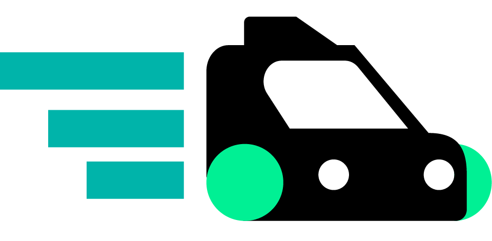
  </picture>

# TADÚ — A mobility platform for taxi stands

> Two mobile apps, an admin panel and a serverless backend that digitize the traditional
> **taxi stand** model in Uruapan, Michoacán (Mexico).

> **This repository is a showcase only.** It contains a description of the project, screenshots
> and design decisions. The source code is private.

  

  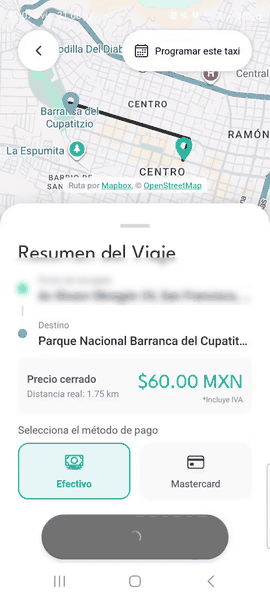

---

## The problem

In a mid-sized city, getting a taxi still means a phone call or a radio. The passenger doesn't
know who is coming or when they'll arrive, the driver depends on someone telling them, and
nobody keeps a record of the trip.

A taxi stand has an advantage that generic ride-hailing apps don't use: **the driver is already
waiting at a known physical spot**. TADÚ starts from there:

- The passenger picks the **base** (the taxi organization) they want service from.
- The driver **checks in** at their **stand** and joins a queue.
- The system assigns the trip to the **first available driver**: no calls, no middlemen.
- The trip is recorded: distance-based price, real-time status, history, and payment in cash
  or by card.

## What's included

| Piece               | For whom               | What it does                                                                                                         |
| ------------------- | ---------------------- | -------------------------------------------------------------------------------------------------------------------- |
| **Passenger app**   | Whoever needs a taxi   | Sign-up, destination search with autocomplete, base selection, live map tracking, payment, history, scheduled trips  |
| **Driver app**      | Whoever drives         | Onboarding with an enrollment code, stand check-in, automatic trip dispatch, wallet, passenger rating                |
| **Admin panel**     | Whoever runs the base  | Driver onboarding and review, documents and enrollment codes, with mandatory MFA                                     |
| **Backend**         | —                      | Serverless API on AWS: 40+ Lambda functions, a NoSQL database, authentication, payments and scheduled jobs           |

> The apps are in Spanish, as they are built for a Spanish-speaking city.

### Passenger app

  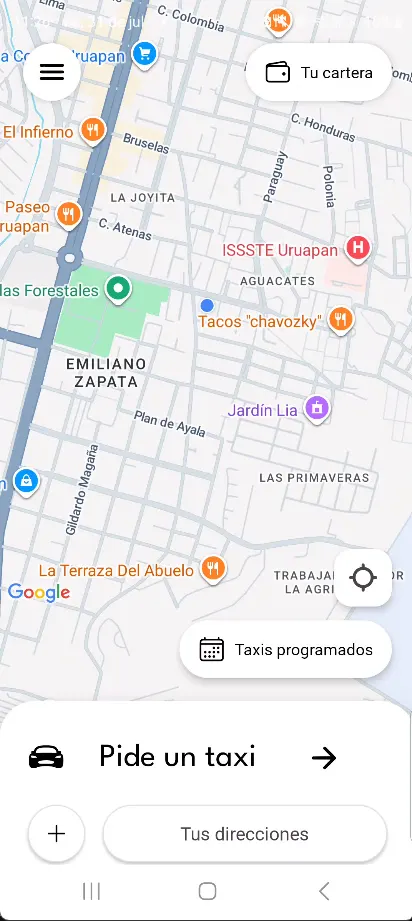
  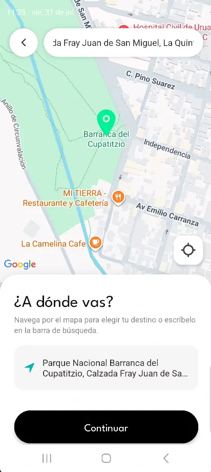
  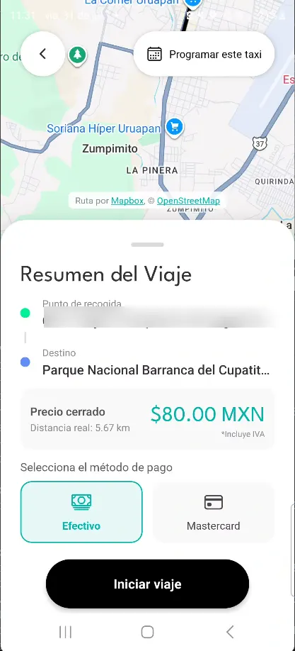
  

### Driver app

  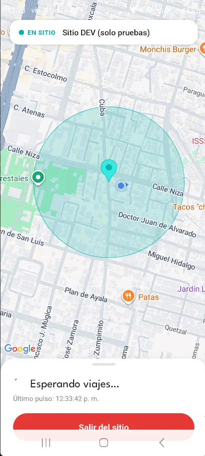
  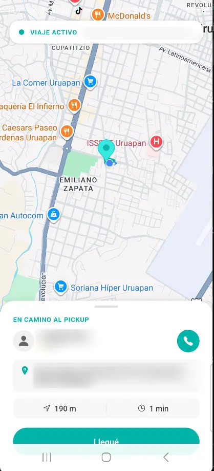
  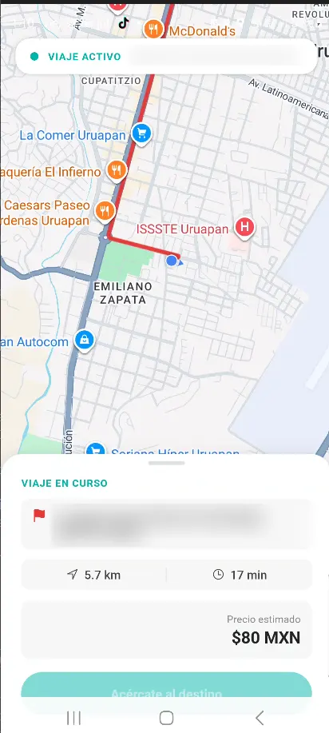
  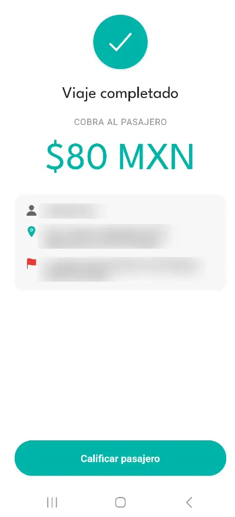

### Admin panel

  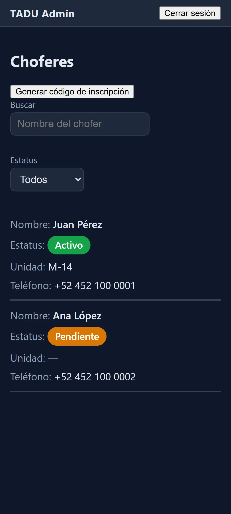
  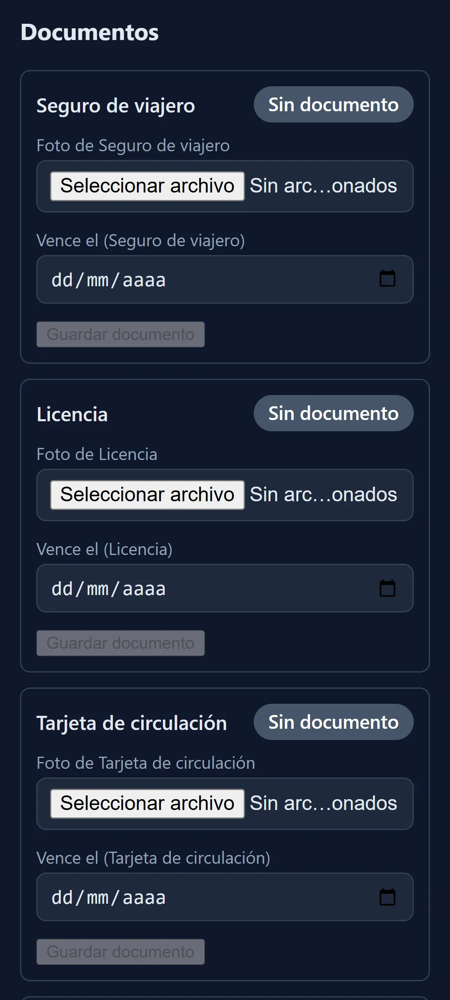
  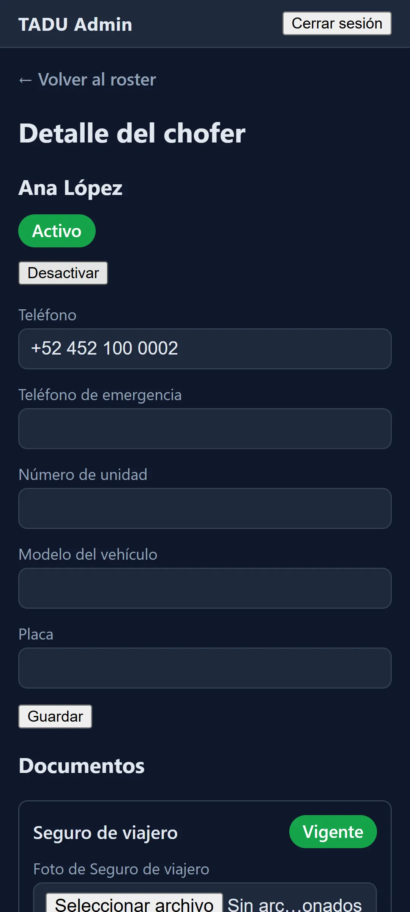

## Architecture at a glance

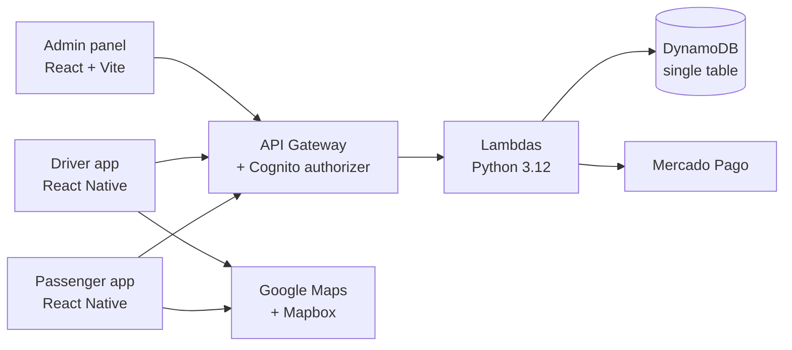

More detail in [`docs/architecture.md`](docs/architecture.md).

## Stack

| Layer          | Technology                                                                    |
| -------------- | ----------------------------------------------------------------------------- |
| Mobile apps    | React Native 0.81, Expo SDK 54, EAS Build                                     |
| Web panel      | React 19, Vite                                                                |
| Shared code    | Internal package used by all three apps (monorepo with npm workspaces)        |
| Backend        | AWS SAM, Lambda (Python 3.12), API Gateway, DynamoDB, Cognito, EventBridge    |
| Integrations   | Mercado Pago (payments), Google Maps and Places, Mapbox Directions            |
| Observability  | Sentry                                                                        |
| Quality        | ESLint, Prettier, TypeScript (gradual migration), Vitest, pytest, CodeScene   |
| CI             | GitHub Actions with a single verification gate                                |

## Decisions worth a look

Seven architecture decisions are documented with their context and what was given up in each,
in [`docs/decisions.md`](docs/decisions.md). The three that best tell the story of the project:

1. **FIFO assignment, no offers.** The "Uber-style" accept/reject model was dropped: a physical
   check-in at the stand is already a statement of availability, and offers only add latency and
   intermediate states.
2. **DynamoDB with a single table and four indexes.** The access patterns were few and well
   known (driver queue per base, history per passenger, history per driver, sessions about to
   expire), so they were modeled first and the schema followed.
3. **Card data never touches the backend.** The card is tokenized on the client directly with the
   payment processor, which keeps PCI compliance at its simplest level.

## Engineering, not just features

A big part of the work was making the project **safe to change**.
[`docs/challenges.md`](docs/challenges.md) tells the most instructive cases:

- A CI gate that was **green without having run a single test**.
- A test that passed in the morning and **failed at night** because of a fixed date compared against UTC.
- **Fares calculated on the server**, not on the client, and payment idempotency.
- A history-based code quality check (CodeScene) that **blocked a PR over 0.02 points**.
- Cutting calls to Mapbox and Google Places **without users noticing**.

## By the numbers

Figures taken from the repository as of 30 Sep 2026:

| Measure                          | Value                      |
| -------------------------------- | -------------------------- |
| Commits                          | ~590                       |
| Releases recorded in CHANGELOG   | 100+ (current: 1.30.29)    |
| First commit                     | Dec 2025                   |
| Frontend tests (Vitest)          | ~395 across 46 files       |
| Backend tests (pytest)           | 200+                       |
| Python Lambda functions          | 41                         |
| Team size                        | 2                          |

## Team

Two co-founders built TADÚ end to end.

- **Zabdiel Cervantes** — mobile apps (passenger and driver), admin panel, shared package, CI and code quality.
- **Gabriel Salse** — backend, cloud infrastructure and payments.

## Project status

**In development.**

## Contact

| | Zabdiel Cervantes | Gabriel Salse |
| --- | --- | --- |
| LinkedIn | [Profile](https://www.linkedin.com/in/zabdiel-rios-cervantes/) | [Profile](https://www.linkedin.com/in/salse-arzate-gabriel-b5b4a326b/) |
| Email | [zrioscervantes@gmail.com](mailto:zrioscervantes@gmail.com) | [salsearzategabriel@gmail.com](mailto:salsearzategabriel@gmail.com) |

Portfolio: [chillipeeper1.github.io/portafolio](https://chillipeeper1.github.io/portafolio/)

---

© 2026 — All rights reserved. See [LICENSE](LICENSE).
