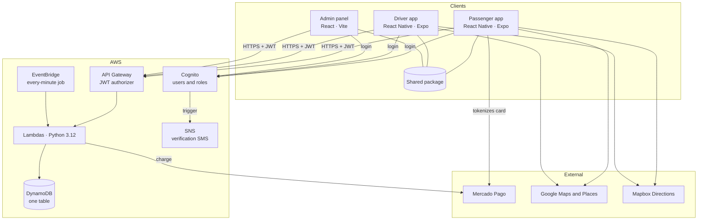
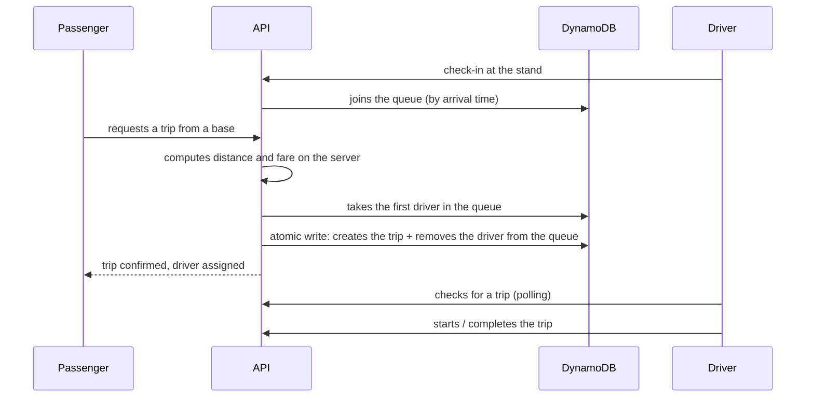
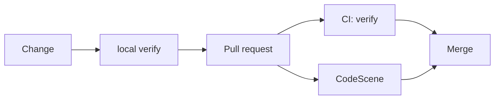

<b>🇬🇧 English</b> · <a href="es/arquitectura.md">🇲🇽 Español</a>

# Architecture

A high-level summary. It does not include resource names, identifiers or infrastructure
configuration.

## Overview

TADÚ is a **monorepo** with three applications and a serverless backend. The apps share an
internal package with common logic (price calculation, zone validation, error handling, map
and trip-tracking hooks), so a business rule lives in one place only.

## Domain concepts

| Concept    | What it is                                                                                         |
| ---------- | -------------------------------------------------------------------------------------------------- |
| **Base**   | The taxi organization. It has a name, a phone number and a per-trip commission.                    |
| **Stand**  | A georeferenced physical spot of a base where drivers wait for customers (~80 m radius).           |
| **Queue**  | The order in which drivers checked in at a stand. The first one gets the next trip.                |

## How a trip is assigned

Two details that matter:

- **Assignment is atomic.** Creating the trip and marking the driver as busy happen in a single
  conditional transaction. If two passengers request at once and compete for the same driver,
  one of them gets a conflict and retries; a driver is never assigned twice.
- **The client doesn't decide the fare.** The server computes distance and price, and that is
  the only value used to charge.

## Driver sessions that don't hang around

The driver sends their position every few seconds (a _heartbeat_). A scheduled job that runs
every minute looks for drivers whose last signal is too old and removes them from the queue.
That way, a phone with a dead battery or no coverage doesn't keep receiving trips nobody will
serve.

The index that makes this search efficient is **sparse**: it only contains drivers with an
active session, so the query never walks the whole user base.

## Data model

A single DynamoDB table holds profiles, trips, payments and sessions, told apart by the prefix
of their keys. Four secondary indexes answer the four questions operations need:

| Index | Question it answers                                  |
| ----- | ---------------------------------------------------- |
| 1     | Who is the next driver in this base's queue?         |
| 2     | Which trips has this passenger taken?                |
| 3     | Which trips has this driver served?                  |
| 4     | Which sessions have gone too long without a signal?  |

## Maps

Two providers are used, each for a different job:

- **Google Maps** draws the map and handles address search.
- **Mapbox Directions** computes the route and distance, and snaps pins to the nearest street.

If Mapbox doesn't respond, tracking falls back to a straight line between points instead of
breaking the screen.

## Security

Design principles, without implementation detail:

- **Centralized authentication.** A single identity service issues the token and the API
  validates it before running any function.
- **Identity comes from the token,** never from data the client can modify.
- **The server decides.** Fares, trip states and permissions are computed and checked in the
  backend, not in the apps.
- **Delegated payments.** Card data is handled by the payment processor, not by our own servers,
  and every charge is idempotent.
- **Second factor for administration,** enforced on the server.
- **Rate limits** on the API and on sensitive operations.
- **Backup and recovery** of the data.
- **Privacy in logs:** logs use opaque identifiers, never personal data.

## Quality and delivery

`verify` is a single command that runs, in order: lint, formatting, types, frontend tests and
backend tests. The same command runs in CI, so what is green locally is green there.
CodeScene checks on every PR whether the change worsens the health of the most frequently
touched files.
