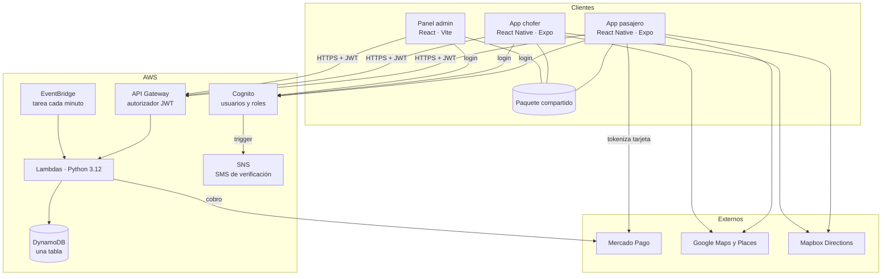
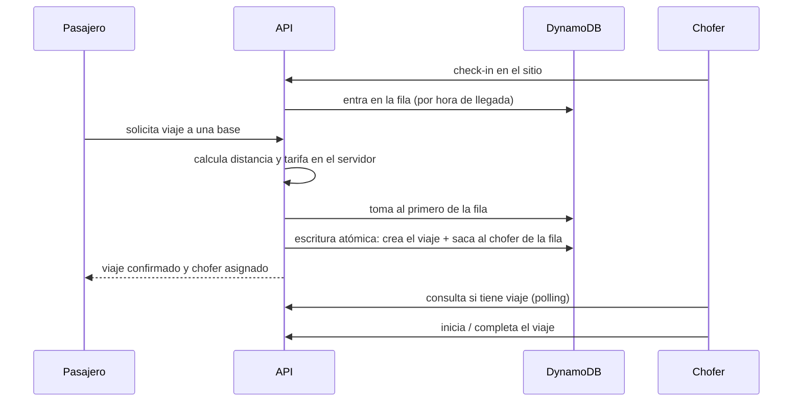
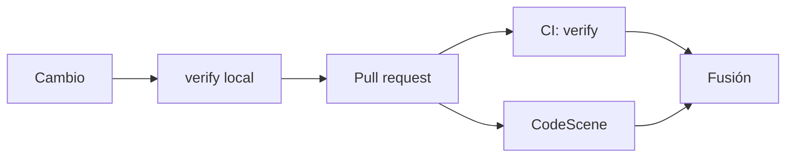

<a href="../architecture.md">🇬🇧 English</a> · <b>🇲🇽 Español</b>

# Arquitectura

Resumen de alto nivel. No incluye nombres de recursos, identificadores ni configuración de
infraestructura.

## Vista general

TADÚ es un **monorepo** con tres aplicaciones y un backend serverless. Las apps comparten un
paquete interno con la lógica común (cálculo de precios, validación de zona, manejo de errores,
hooks de mapa y de seguimiento de viaje), de modo que una regla de negocio vive en un solo
lugar.

## Conceptos del dominio

| Concepto  | Qué es                                                                                          |
| --------- | ----------------------------------------------------------------------------------------------- |
| **Base**  | La organización de taxis. Tiene nombre, teléfono y una comisión por viaje.                      |
| **Sitio** | Punto físico georreferenciado de una base donde los choferes esperan clientes (radio de ~80 m). |
| **Fila**  | Orden en que los choferes hicieron _check-in_ en un sitio. El primero recibe el siguiente viaje. |

## Cómo se asigna un viaje

Dos detalles que importan:

- **La asignación es atómica.** Crear el viaje y marcar al chofer como ocupado ocurren en una sola
  transacción condicional. Si dos pasajeros piden a la vez y compiten por el mismo chofer, uno de
  los dos recibe un conflicto y reintenta, nunca se asigna dos veces.
- **La tarifa no la decide el cliente.** El servidor calcula distancia y precio y es el único
  valor que se usa para cobrar.

## Sesiones de chofer que no se quedan colgadas

El chofer envía su posición cada pocos segundos (_heartbeat_). Una tarea programada que corre
cada minuto busca a los choferes cuya última señal es demasiado antigua y los saca de la fila.
Así, un teléfono sin batería o sin cobertura no sigue recibiendo viajes que nadie va a atender.

El índice que hace eficiente esta búsqueda es **disperso**: solo contiene a los choferes con
sesión activa, así que la consulta no recorre a toda la base de usuarios.

## Modelo de datos

Una sola tabla en DynamoDB guarda perfiles, viajes, pagos y sesiones, distinguidos por el
prefijo de sus claves. Cuatro índices secundarios responden las cuatro preguntas que la
operación necesita:

| Índice | Pregunta que responde                              |
| ------ | -------------------------------------------------- |
| 1      | ¿Quién es el siguiente chofer en la fila de la base? |
| 2      | ¿Qué viajes ha hecho este pasajero?                |
| 3      | ¿Qué viajes ha hecho este chofer?                  |
| 4      | ¿Qué sesiones llevan demasiado tiempo sin señal?   |

## Mapas

Se usan dos proveedores con funciones distintas:

- **Google Maps** dibuja el mapa y resuelve búsqueda de direcciones.
- **Mapbox Directions** calcula la ruta, la distancia y ajusta los pines a la calle más cercana.

Si Mapbox no responde, el seguimiento cae a una línea recta entre los puntos en lugar de romper
la pantalla.

## Seguridad

Principios de diseño, sin detalle de implementación:

- **Autenticación centralizada.** Un único servicio de identidad emite el token y la API lo valida
  antes de ejecutar cualquier función.
- **La identidad sale del token,** nunca de datos que el cliente pueda modificar.
- **El servidor decide.** Tarifas, estados del viaje y permisos se calculan y comprueban en el
  backend, no en las apps.
- **Pagos delegados.** Los datos de tarjeta los maneja el procesador de pagos, no los servidores
  propios, y cada cobro es idempotente.
- **Administración con segundo factor** exigido en el servidor.
- **Límites de uso** en la API y en las operaciones sensibles.
- **Respaldo y recuperación** de los datos.
- **Privacidad en los registros:** los logs usan identificadores opacos, sin datos personales.

## Calidad y entrega

`verify` es un solo comando que corre, en orden: lint, formato, tipos, pruebas de frontend y
pruebas de backend. El mismo comando corre en CI, así que lo que está verde en local está verde
allá. CodeScene revisa en cada PR si el cambio empeora la salud del código en los archivos que
más se tocan.
